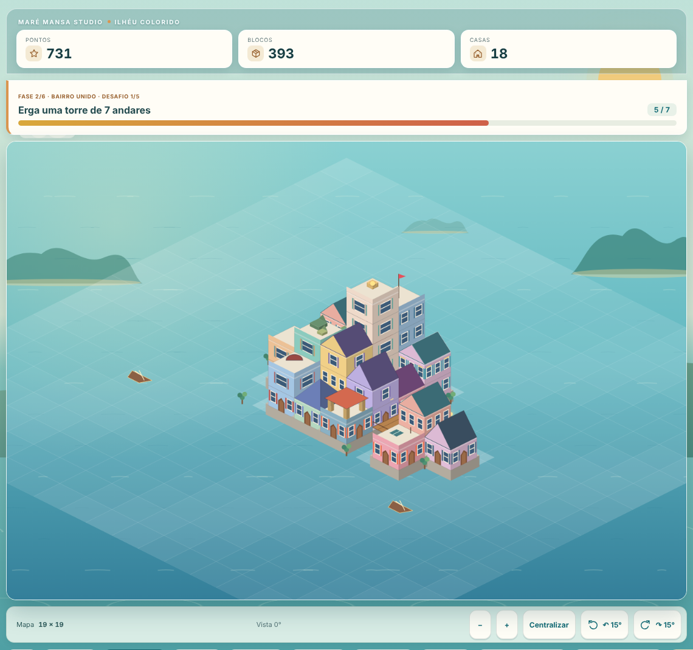
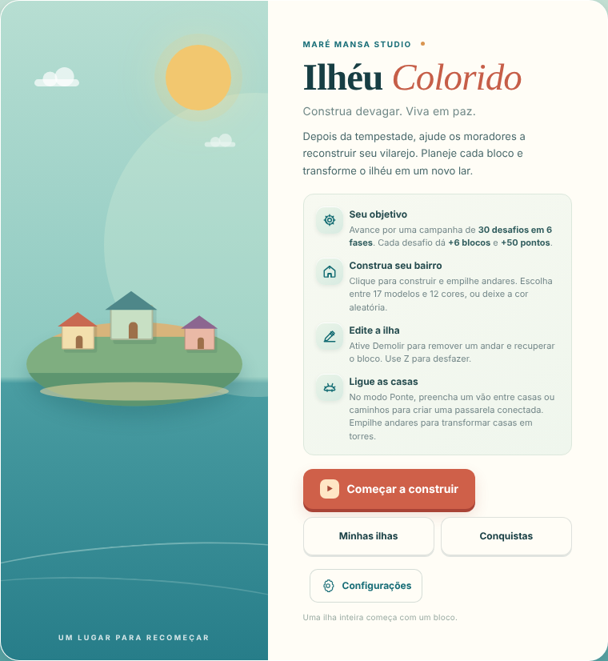
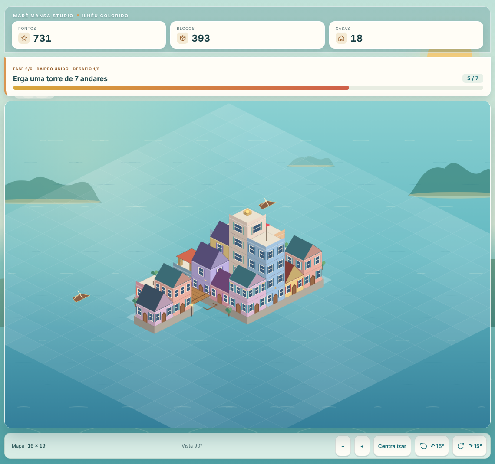
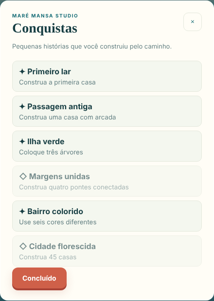
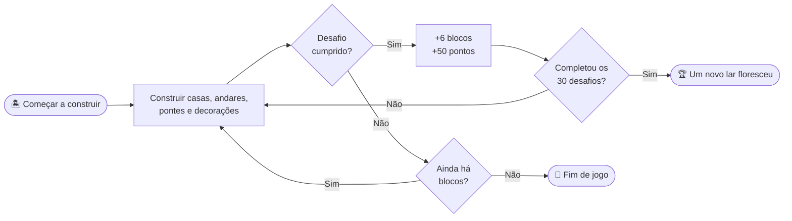

<p align="center">
  
</p>

<h1 align="center">🏝️ Ilhéu Colorido</h1>

<p align="center">
  <em>Construa devagar. Viva em paz.</em>
</p>

<p align="center">
  Um jogo de construção isométrico, tranquilo e colorido, feito do zero com HTML, CSS e JavaScript puro.<br>
  Depois da tempestade, ajude os moradores a reconstruir o vilarejo e transforme o ilhéu em um novo lar.
</p>

<p align="center">
  
  
  
  
</p>

<p align="center">
  
</p>

---

## 📋 Índice

- [Sobre o projeto](#-sobre-o-projeto)
- [Capturas de tela](#-capturas-de-tela)
- [Funcionalidades](#-funcionalidades)
- [Como jogar](#-como-jogar)
- [Pontuação e campanha](#-pontuação-e-campanha)
- [Conquistas](#-conquistas)
- [Tecnologias utilizadas](#-tecnologias-utilizadas)
- [Como executar](#-como-executar)
- [Estrutura do projeto](#-estrutura-do-projeto)
- [Ideias para o futuro](#-ideias-para-o-futuro)
- [Autor](#-autor)

---

## 📖 Sobre o projeto

**Ilhéu Colorido** é um jogo de construção casual, sem pressa e sem pressão. Você recebe alguns blocos, escolhe onde construir e vai erguendo casas, torres, pontes e jardins sobre um mapa de **19 × 19** células cercado pelo mar.

Uma campanha de **30 desafios divididos em 6 fases** guia a reconstrução: cada pedido cumprido rende **+6 blocos** e **+50 pontos**, e cada bloco precisa ser bem planejado. Se preferir apenas criar, o **Modo livre** oferece blocos infinitos.

O projeto foi desenvolvido pelo **Maré Mansa Studio** e roda direto no navegador, sem instalação, sem frameworks e sem bibliotecas externas. Todo o visual isométrico é desenhado em tempo real em um `<canvas>`, e até os efeitos sonoros são sintetizados no código.

---

## 🖼️ Capturas de tela

### Tela inicial

<p align="center">
  
</p>

Apresentação do jogo, regras resumidas, acesso a **Minhas ilhas**, **Conquistas** e **Configurações**, e o botão **Continuar partida** quando existe um progresso salvo.

### Construindo o vilarejo

<p align="center">
  
</p>

O painel mostra **pontos**, **blocos** e **casas**, além do desafio atual com barra de progresso.

### Câmera giratória

<p align="center">
  
</p>

O mapa pode ser girado de 15° em 15°, aproximado, afastado e movido. Na imagem acima, a **ponte de madeira** liga duas margens do bairro.

### Conquistas, configurações e versão mobile

<table align="center">
  <tr>
    <td align="center"><br><sub>Conquistas</sub></td>
    <td align="center"><br><sub>Configurações</sub></td>
    <td align="center"><br><sub>No celular</sub></td>
  </tr>
</table>

---

## ✨ Funcionalidades

**Construção**
- 🏠 **17 modelos de casa**: Clássica, Torre, Chalé, Varanda, Sótão, Jardim, Pátio, Pavilhão, Rotunda, Farol, Casa de praia, Telhado verde, Coreto, Observatório, Telhado piramidal, Arcada e Escadaria.
- 🎨 **12 cores** (Pêssego, Girassol, Menta, Brisa, Lavanda, Areia, Folha, Coral, Turquesa, Lilás, Concha e Oceano) ou cor aleatória, que evita repetir a cor das casas vizinhas.
- 🏗️ **Andares empilháveis** até o limite de **7**, transformando casas em torres.
- 🌉 **Modo Ponte**: preencha o vão entre duas casas ou caminhos para criar uma passarela conectada.
- 🌳 **Modo Decorar**: árvore, poste de luz, barco (só na água) e banco.
- 🔨 **Modo Demolir**: remove um andar, uma ponte ou uma decoração e devolve o bloco.
- ↩️ **Desfazer** até as últimas 30 ações.

**Progressão**
- 🎯 Campanha com **30 desafios em 6 fases**: *Primeiros lares*, *Bairro unido*, *Ilha em expansão*, *Torres e caminhos*, *Comunidade viva* e *Ilha florescida*.
- ⭐ Avaliação de até **3 estrelas** no final e **melhor pontuação** guardada.
- 🏆 **6 conquistas** desbloqueáveis.
- ♾️ **Modo livre** com blocos infinitos para criar sem se preocupar com recursos.

**Câmera e visual**
- 🔄 Rotação do mapa, zoom, movimentação e botão **Centralizar**.
- 🌊 Cenário animado com sol, nuvens, pássaros, ilhas distantes e ondas.
- 🔊 Efeitos sonoros gerados por código, com controle de volume.

**Salvamento**
- 💾 **Salvamento automático** no navegador, com botão **Continuar partida**.
- 🏝️ **Minhas ilhas**: salve até **8 vilarejos**, renomeie, reabra, exclua e **exporte a ilha como imagem PNG**.

**Acessibilidade**
- ♿ **Alto contraste**, **interface ampliada** e **paleta de cores alternativa** para diferenciar melhor as casas.
- ⌨️ Jogo totalmente jogável pelo **teclado**, com rótulos ARIA e anúncios para leitores de tela.
- 🧘 Opção para **reduzir animações**, que já respeita a preferência de movimento reduzido do sistema.

---

## 🕹️ Como jogar

1. Na tela inicial, clique em **Começar a construir** (ou em **Continuar partida**, se houver progresso salvo).
2. Você começa com **20 blocos**. Cada clique em uma célula livre constrói uma casa e gasta 1 bloco.
3. Clique de novo na mesma casa para **empilhar andares** (até 7).
4. Escolha o **modelo** e a **cor** da próxima construção nos controles abaixo do mapa.
5. Use **Ponte** para ligar casas separadas por um vão e **Decorar** para deixar a ilha mais bonita.
6. Use **Demolir** para remover um andar e recuperar o bloco. Se errou, use **Desfazer**.
7. Cumpra o **desafio** mostrado no topo para ganhar **+6 blocos** e **+50 pontos**.
8. **Vitória:** conclua os 30 desafios. **Fim de jogo:** os blocos acabam antes disso.

### Fluxo do jogo



### Controles

| Ação | Mouse / toque | Teclado |
| ---- | ------------- | ------- |
| Construir / empilhar andar | Clique ou toque na célula | `Enter` ou `Espaço` |
| Demolir | Botão direito (ou modo **Demolir**) | `D` alterna o modo Demolir |
| Desfazer | Botão **Desfazer** | `Z` |
| Navegar pelo tabuleiro | Passar o mouse | Setas |
| Trocar modelo da casa | Menu **Modelo** | `M` |
| Girar a câmera | Arrastar com o botão esquerdo, `Shift` + roda, ou botões ↶ ↷ | `Q` e `E` (15° por vez) |
| Mover a câmera | `Alt` + arrastar, ou botão do meio | — |
| Zoom | Roda do mouse, ou botões **+** e **−** | — |
| Centralizar a câmera | Botão **Centralizar** | — |

---

## 🧮 Pontuação e campanha

| Ação | Pontos |
| ---- | ------ |
| Construir uma casa nova | **10** + **5** por casa vizinha |
| Adicionar um andar | **5** + **3** × andares que a casa já tem |
| Construir uma ponte | **4** |
| Cumprir um desafio | **50** (e **+6 blocos**) |
| Demolir um andar | **−5** (e recupera 1 bloco) |

Os desafios variam entre construir casas, **unir casas num mesmo bairro** (conectadas lado a lado ou por pontes), erguer **torres** (4 andares ou mais), somar **andares** na ilha e **ligar bairros com pontes**. A dificuldade aumenta a cada fase, e a última etapa pede, por exemplo, somar 180 andares e expandir a rede para 8 pontes.

---

## 🏆 Conquistas

| Conquista | Como desbloquear |
| --------- | ---------------- |
| ✦ **Primeiro lar** | Construa a primeira casa |
| ✦ **Passagem antiga** | Construa uma casa com arcada |
| ✦ **Ilha verde** | Coloque três árvores |
| ✦ **Margens unidas** | Construa quatro pontes conectadas |
| ✦ **Bairro colorido** | Use seis cores diferentes |
| ✦ **Cidade florescida** | Construa 45 casas |

---

## 🛠️ Tecnologias utilizadas

<p align="center">
  
</p>

| Tecnologia | Uso no projeto |
| ---------- | -------------- |
| **HTML5** | Estrutura das telas, diálogos nativos (`<dialog>`) e `<canvas>` |
| **CSS3** | Layout com Flexbox e Grid, variáveis CSS, animações, temas de acessibilidade e design responsivo |
| **JavaScript (ES6+)** | Toda a lógica do jogo, sem frameworks nem bibliotecas |
| **Canvas 2D API** | Renderização isométrica em tempo real, com ordenação de profundidade e rotação de câmera |
| **Web Audio API** | Efeitos sonoros sintetizados com osciladores, sem arquivos de áudio |
| **Pointer Events** | Controle unificado de mouse e toque |
| **localStorage** | Salvamento automático, preferências, melhor pontuação, conquistas e ilhas salvas |

---

## 🚀 Como executar

Não é preciso instalar nada. O jogo roda direto no navegador.

```bash
# 1. Clone o repositório
git clone https://github.com/theosouzaa/Mini-Game.git

# 2. Entre na pasta do jogo
cd Mini-Game/MiniGamee
```

**Opção 1:** abra o arquivo `index.html` com um duplo clique.

**Opção 2:** rode um servidor local, se preferir:

```bash
# Python 3
python -m http.server 8000
# depois acesse http://localhost:8000
```

> 💡 Suas preferências e progresso ficam salvos no próprio navegador (`localStorage`).

---

## 📁 Estrutura do projeto

```text
Mini-Game/
├── docs/                  # Capturas de tela usadas neste README
├── MiniGamee/
│   ├── index.html         # Telas do jogo, painéis e diálogos
│   ├── style.css          # Visual, cenário animado, responsividade e acessibilidade
│   └── script.js          # Lógica, renderização no canvas, áudio e salvamento
└── README.md
```

---

## 🔮 Ideias para o futuro

- [ ] Novos modelos de casa e mais decorações
- [ ] Mais fases e desafios para a campanha
- [ ] Ciclo de dia e noite com os postes acendendo
- [ ] Trilha sonora ambiente
- [ ] Publicar o jogo online com GitHub Pages

---

## 👤 Autor

Desenvolvido por **[@theosouzaa](https://github.com/theosouzaa)** · Maré Mansa Studio

Gostou do projeto? Deixe uma ⭐ no repositório!
