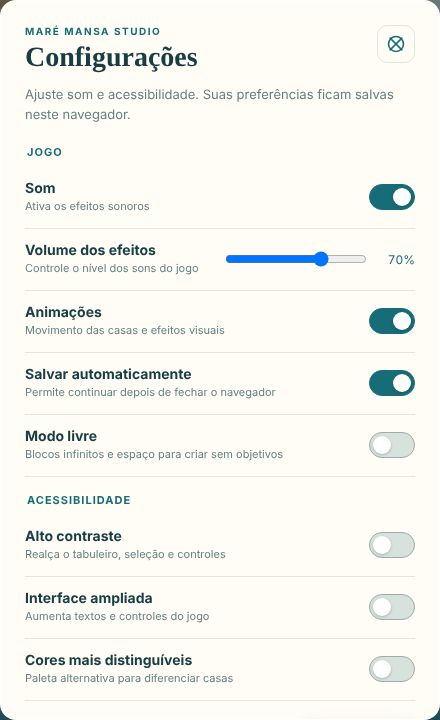
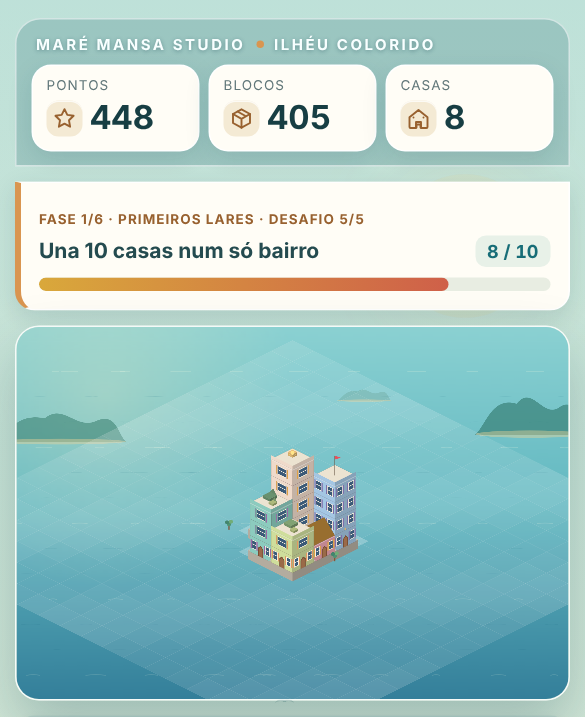
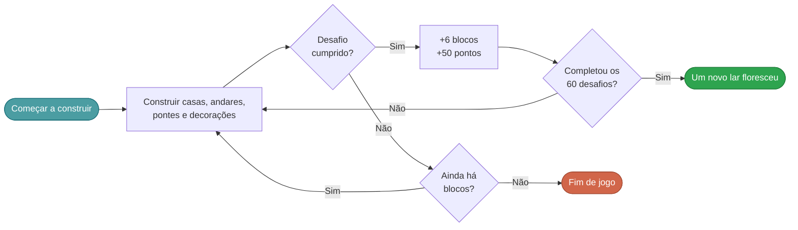

<p align="center">
  
</p>

<p align="center">
  Um jogo de construção isométrico, tranquilo e colorido, feito do zero com HTML, CSS e JavaScript puro.<br>
  Depois da tempestade, ajude os moradores a reconstruir o vilarejo e transforme o ilhéu em um novo lar.
</p>

<p align="center">
  
  
  
  
  
</p>

<p align="center">
  
</p>

<p align="center">
  <a href="#sobre-o-projeto"> Sobre</a> &nbsp;•&nbsp;
  <a href="#início-rápido"> Início rápido</a> &nbsp;•&nbsp;
  <a href="#funcionalidades"> Funcionalidades</a> &nbsp;•&nbsp;
  <a href="#como-jogar"> Como jogar</a> &nbsp;•&nbsp;
  <a href="#pontuação-e-campanha"> Pontuação</a> &nbsp;•&nbsp;
  <a href="#conquistas"> Conquistas</a> &nbsp;•&nbsp;
  <a href="#tecnologias"> Tecnologias</a>
</p>

---

## Sobre o projeto

**Ilhéu Colorido** é um jogo de construção casual, sem pressa e sem pressão. Você recebe alguns blocos, escolhe onde construir e vai erguendo casas, torres, pontes e jardins sobre um mapa de **19 × 19** células cercado pelo mar.

Uma campanha de **60 desafios divididos em 12 fases** guia a reconstrução: cada pedido cumprido rende **+6 blocos** e **+50 pontos**, e cada bloco precisa ser bem planejado. Moradores passeiam pela ilha, enquanto o indicador de bem-estar responde às casas, árvores, flores, postes e pontes. Se preferir apenas criar, o **Modo livre** oferece blocos infinitos.

O projeto foi desenvolvido pelo **Maré Mansa Studio** e roda direto no navegador, sem instalação, sem frameworks e sem bibliotecas externas. Todo o visual isométrico é desenhado em tempo real em um `<canvas>`, e os efeitos sonoros e a trilha ambiente são sintetizados no código.

### Em números

<table align="center">
  <tr>
    <td align="center" width="140"><br><b>19 × 19</b><br><sub>células no mapa</sub></td>
    <td align="center" width="140"><br><b>23</b><br><sub>modelos de casa</sub></td>
    <td align="center" width="140"><br><b>12</b><br><sub>cores</sub></td>
    <td align="center" width="140"><br><b>60</b><br><sub>desafios em 12 fases</sub></td>
    <td align="center" width="140"><br><b>14</b><br><sub>conquistas ilustradas</sub></td>
  </tr>
</table>

---

## Início rápido

Não é preciso instalar nada. O jogo roda direto no navegador.

```bash
git clone https://github.com/theosouzaa/Mini-Game.git
cd Mini-Game/MiniGamee
```

Depois, abra o `index.html` com um duplo clique. Se preferir um servidor local:

```bash
python -m http.server 8000
# acesse http://localhost:8000
```

> [!NOTE]
> Preferências e progresso ficam salvos no próprio navegador (`localStorage`).

---

## Capturas de tela

<table align="center">
  <tr>
    <td align="center" width="50%">
      <br>
      <b>Tela inicial</b><br>
      <sub>Regras resumidas, <i>Minhas ilhas</i>, <i>Conquistas</i>, <i>Configurações</i> e o botão <i>Continuar partida</i> quando há progresso salvo.</sub>
    </td>
    <td align="center" width="50%">
      <br>
      <b>Construindo o vilarejo</b><br>
      <sub>O painel mostra <i>pontos</i>, <i>blocos</i> e <i>casas</i>, além do desafio atual com barra de progresso.</sub>
    </td>
  </tr>
  <tr>
    <td align="center" colspan="2">
      <br>
      <b>Câmera giratória</b><br>
      <sub>O mapa gira de 15° em 15°, aproxima, afasta e se move. Aqui, a ponte de madeira liga duas margens do bairro.</sub>
    </td>
  </tr>
</table>

<table align="center">
  <tr>
    <td align="center"><br><sub><b>Conquistas</b></sub></td>
    <td align="center"><br><sub><b>Configurações</b></sub></td>
    <td align="center"><br><sub><b>No celular</b></sub></td>
  </tr>
</table>

---

## Funcionalidades

###  Construção

| | Recurso | Detalhes |
| :-: | ------- | -------- |
|  | **23 modelos de casa** | Inclui Moinho, Estufa, Pagode, Cabana, Casa-barco e Solar, além dos modelos originais |
|  | **12 cores** | Pêssego, Girassol, Menta, Brisa, Lavanda, Areia, Folha, Coral, Turquesa, Lilás, Concha e Oceano, ou cor aleatória, que evita repetir a cor das casas vizinhas |
|  | **Andares empilháveis** | Até **7 andares**, transformando casas em torres |
|  | **Modo Ponte** | Preencha o vão entre duas casas ou caminhos para criar uma passarela conectada |
|  | **Modo Decorar** | Árvore, poste de luz, barco (só na água), banco, flores, fonte, pedra e lanterna |
|  | **Modo Demolir** | Remove um andar, uma ponte ou uma decoração e devolve o bloco |
|  | **Desfazer e refazer** | Volte ou reaplique ações recentes; o histórico vale durante a sessão atual |

###  Progressão

| | Recurso | Detalhes |
| :-: | ------- | -------- |
|  | **Campanha** | 60 desafios em 12 fases, com metas de casas, bairros, torres, andares e pontes |
|  | **Avaliação** | Até 3 estrelas no final, com a melhor pontuação guardada |
|  | **Conquistas** | 14 conquistas desbloqueáveis, cada uma com emblema SVG exclusivo e aviso sonoro na partida |
|  | **Modo livre** | Blocos infinitos para criar sem se preocupar com recursos |
|  | **Moradores e bem-estar** | Pequenos moradores circulam entre as casas; o indicador considera casas e elementos de convivência |

###  Câmera e visual

| | Recurso | Detalhes |
| :-: | ------- | -------- |
|  | **Câmera livre** | Rotação do mapa, zoom, movimentação e botão **Centralizar** |
|  | **Cenário e clima** | Ciclo de dia e noite, escolha de dia/noite fixos, chuva, lua, estrelas, postes iluminados e velocidade das animações |
|  | **Áudio sintetizado** | Efeitos sonoros e trilha ambiente gerados por código, com controle de som, trilha e volume |

###  Salvamento

| | Recurso | Detalhes |
| :-: | ------- | -------- |
|  | **Automático** | Progresso salvo no navegador, com botão **Continuar partida** |
|  | **Minhas ilhas** | Salve até **8 vilarejos**, renomeie, reabra, exclua e **exporte a ilha como imagem PNG** |

###  Acessibilidade

| | Recurso | Detalhes |
| :-: | ------- | -------- |
|  | **Visual adaptável** | Alto contraste, interface ampliada e paleta alternativa para diferenciar melhor as casas |
|  | **Teclado e leitores de tela** | Totalmente jogável pelo teclado, com rótulos ARIA e anúncios para leitores de tela |
|  | **Menos movimento** | Opção para reduzir animações, que já respeita a preferência do sistema |

---

## Como jogar

<table>
  <tr>
    <td width="48" align="center"><b>1</b></td>
    <td>Na tela inicial, clique em <b>Começar a construir</b> (ou em <b>Continuar partida</b>, se houver progresso salvo).</td>
  </tr>
  <tr>
    <td align="center"><b>2</b></td>
    <td>Você começa com <b>20 blocos</b>. Cada clique em uma célula livre constrói uma casa e gasta 1 bloco.</td>
  </tr>
  <tr>
    <td align="center"><b>3</b></td>
    <td>Clique de novo na mesma casa para <b>empilhar andares</b> (até 7).</td>
  </tr>
  <tr>
    <td align="center"><b>4</b></td>
    <td>Escolha o <b>modelo</b> e a <b>cor</b> da próxima construção nos controles abaixo do mapa.</td>
  </tr>
  <tr>
    <td align="center"><b>5</b></td>
    <td>Use <b>Ponte</b> para ligar casas separadas por um vão e <b>Decorar</b> para embelezar a ilha.</td>
  </tr>
  <tr>
    <td align="center"><b>6</b></td>
    <td>Use <b>Demolir</b> para remover um andar e recuperar o bloco. Se errou, use <b>Desfazer</b> ou <b>Refazer</b>.</td>
  </tr>
  <tr>
    <td align="center"><b>7</b></td>
    <td>Cumpra o <b>desafio</b> mostrado no topo para ganhar <b>+6 blocos</b> e <b>+50 pontos</b>.</td>
  </tr>
</table>

> [!IMPORTANT]
> **Vitória:** conclua os 60 desafios. **Fim de jogo:** os blocos acabam antes disso.

### Fluxo do jogo



### Controles

| Ação | Mouse / toque | Teclado |
| ---- | ------------- | ------- |
|  Construir / empilhar andar | Clique ou toque na célula | <kbd>Enter</kbd> ou <kbd>Espaço</kbd> |
|  Demolir | Botão direito (ou modo **Demolir**) | <kbd>D</kbd> alterna o modo Demolir |
|  Desfazer | Botão **Desfazer** | <kbd>Z</kbd> |
|  Refazer | Botão **Refazer** | <kbd>Ctrl</kbd> + <kbd>Y</kbd> |
|  Navegar pelo tabuleiro | Passar o mouse | <kbd>←</kbd> <kbd>↑</kbd> <kbd>↓</kbd> <kbd>→</kbd> |
|  Trocar modelo da casa | Menu **Modelo** | <kbd>M</kbd> |
|  Girar a câmera | Arrastar com o botão esquerdo, <kbd>Shift</kbd> + roda, ou botões ↶ ↷ | <kbd>Q</kbd> e <kbd>E</kbd> (15° por vez) |
|  Mover a câmera | <kbd>Alt</kbd> + arrastar, ou botão do meio | n/d |
|  Zoom | Roda do mouse, ou botões **+** e **−** | n/d |
|  Centralizar a câmera | Botão **Centralizar** | n/d |

O horário, clima e velocidade das animações podem ser ajustados em **Configurações**. A trilha ambiente também pode ser ligada ou desligada por lá.

---

## Pontuação e campanha

| Ação | Pontos |
| ---- | :----- |
| Construir uma casa nova | **+10**, mais **+5** por casa vizinha |
| Adicionar um andar | **+5**, mais **+3** × andares que a casa já tem |
| Construir uma ponte | **+4** |
| Cumprir um desafio | **+50** (e **+6 blocos**) |
| Demolir um andar | **−5** (e recupera 1 bloco) |

Os desafios variam entre construir casas, **unir casas num mesmo bairro** (conectadas lado a lado ou por pontes), erguer **torres** (4 andares ou mais), somar **andares** na ilha e **ligar bairros com pontes**. A dificuldade aumenta a cada fase, e a última etapa pede, por exemplo, somar 180 andares e expandir a rede para 8 pontes.

---

## Conquistas

| | Conquista | Como desbloquear |
| :-: | --------- | ---------------- |
|  | **Primeiro lar** | Construa a primeira casa |
|  | **Passagem antiga** | Construa uma casa com arcada |
|  | **Ilha verde** | Coloque três árvores |
|  | **Margens unidas** | Construa quatro pontes conectadas |
|  | **Bairro colorido** | Use seis cores diferentes |
|  | **Cidade florescida** | Construa 45 casas |
| 🌳 | **Guardião do bosque** | Plante oito árvores |
| 🌸 | **Jardim em festa** | Decore oito espaços com flores |
| 💡 | **Luzes da vila** | Instale cinco postes de luz |
| 🏛️ | **Mestre das formas** | Construa usando dez modelos diferentes |
| 🔦 | **Guardião da costa** | Construa um farol |
| 🌈 | **Paleta completa** | Use dez cores diferentes |
| 🌉 | **Grande travessia** | Construa oito pontes |
| 🏙️ | **Grande cidade** | Construa 80 casas |

---

## Tecnologias

<p align="center">
  
</p>

| Tecnologia | Uso no projeto |
| ---------- | -------------- |
| **HTML5** | Estrutura das telas, diálogos nativos (`<dialog>`) e `<canvas>` |
| **CSS3** | Layout com Flexbox e Grid, variáveis CSS, animações, temas de acessibilidade e design responsivo |
| **JavaScript (ES6+)** | Toda a lógica do jogo, sem frameworks nem bibliotecas |
| **Canvas 2D API** | Renderização isométrica em tempo real, com ordenação de profundidade e rotação de câmera |
| **Web Audio API** | Efeitos sonoros sintetizados com osciladores, sem arquivos de áudio |
| **Pointer Events** | Controle unificado de mouse e toque |
| **localStorage** | Salvamento automático, preferências, melhor pontuação, conquistas e ilhas salvas |

---

## Estrutura do projeto

```text
Mini-Game/
├── docs/                  # Capturas de tela usadas neste README
├── MiniGamee/
│   ├── index.html         # Telas do jogo, painéis e diálogos
│   ├── style.css          # Visual, cenário animado, responsividade e acessibilidade
│   └── script.js          # Lógica, renderização no canvas, áudio e salvamento
└── README.md
```

---

## Ideias para o futuro

- [ ] Novos modelos de casa e mais decorações
- [ ] Mais fases e desafios para a campanha
- [ ] Ciclo de dia e noite com os postes acendendo
- [ ] Trilha sonora ambiente
- [ ] Publicar o jogo online com GitHub Pages

---

<p align="center">
  Desenvolvido por <a href="https://github.com/theosouzaa"> <b>@theosouzaa</b></a> · Maré Mansa Studio<br>
  <sub>Gostou do projeto? Deixe uma  no repositório.</sub>
</p>

<p align="center">
  
</p>
